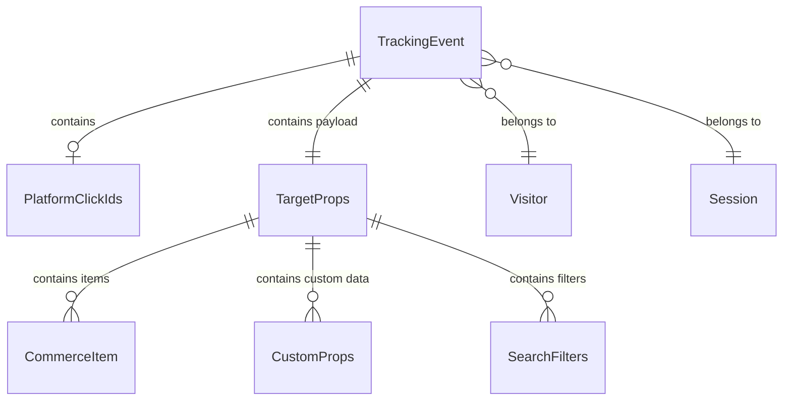
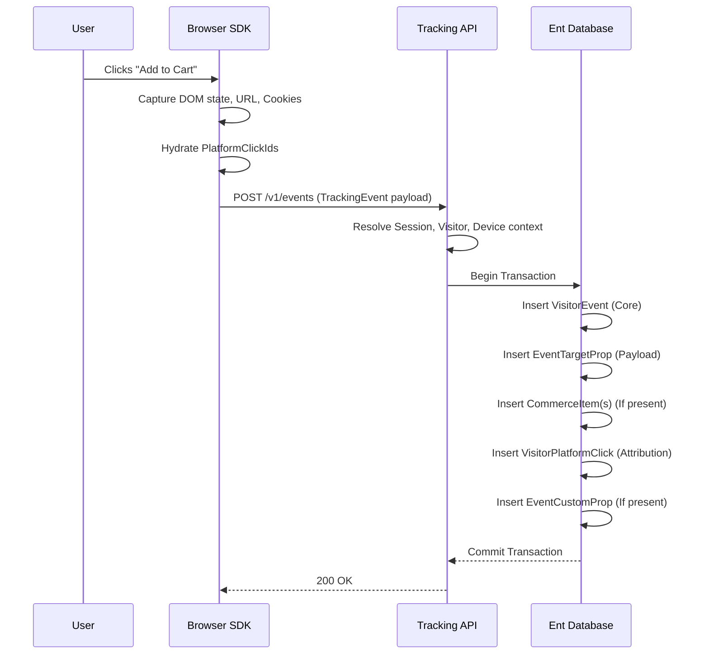

# Event Tracking Anatomy & Structure

This document outlines the architecture, data models, and relationships of the Event Tracking system. It serves as the single source of truth for understanding how frontend interactions are classified, enriched, and stored within the tracking backend.

## 1. High-Level Architecture

The tracking architecture centers around a single, highly extensible payload: the `TrackingEvent`. Rather than creating different shapes for different events, all events share the same top-level root structure. The variance in data is encapsulated within the `target` property and specific relational edges.

## 2. Core Event Anatomy (`TrackingEvent`)

Every event emitted from the client SDK contains mandatory core properties that ensure strict data lineage and proper ordering.

### Identifiers
These fields link the solitary event back to the global entity relationships.
- `event_id`: A UUID v4 string representing the global deduplication key for this specific action.
- `visitor_id`: Links to the persistent device-level visitor entity.
- `session_id`: Links to the current bounded session entity.
- `page_id`: Links to the specific `PageView` entity where this event happened.
- `device_id`: Links to the user's hardware/browser profile.

### Classification & Sequencing
- `type` & `category`: Hierarchical classification strings (e.g., `Type: interaction`, `Category: interaction.click`).
- `name`: A human-readable identifier (e.g., "Product Added to Cart").
- `sequence`: A monotonically increasing integer strictly ordering events within the specific session.
- `occurred_at`: The exact client-side ISO-8601 timestamp with millisecond precision.

---

## 3. The Payload (`TargetProps`)

The `target` property acts as a massive union/bag of context. Instead of nesting deeply, the schema flattens context properties based on domain.

### Domains Covered:

| Domain | Example Properties | Purpose |
| :--- | :--- | :--- |
| **DOM Element** | `element_type`, `element_selector`, `component` | Tracing exactly what UI piece was interacted with (critical for heatmaps/replay). |
| **Forms** | `form_id`, `form_field_count`, `form_completion_pct` | Tracking funnel drop-off inside complex multi-step forms. |
| **Media / Video** | `media_provider`, `media_percent`, `media_quality` | Measuring engagement with video and audio content. |
| **Pointer / Scroll** | `click_x`, `click_y`, `scroll_depth_px` | High-fidelity UI interaction metrics. |
| **Commerce** | `transaction_id`, `value`, `currency`, `items` | Standardized e-commerce tracking (add to cart, checkout, purchase). |
| **System / Errors**| `error_stack`, `error_severity`, `http_status` | Catching and attributing client-side crashes and API failures to user sessions. |

> [!TIP]
> **Custom Properties**
> When a required property doesn't fit into the predefined semantic domains, developers can use the `custom: Record<string, unknown>` escape hatch. In the backend, these are materialized into a relational Key-Value table (`EventCustomProp`).

---

## 4. Commerce Items (`CommerceItem`)

For events categorized under `commerce` (e.g., `commerce.add_to_cart` or `commerce.purchase`), the `target` payload will include an array of items. 

This array is highly standardized to map cleanly to Meta CAPI, Google Analytics 4, and TikTok Events API.

- **Identifiers**: `item_id`, `item_name`, `item_variant`
- **Taxonomy**: `item_category`, `item_category2`, `item_category3`
- **Pricing**: `price`, `quantity`, `discount`
- **Attribution**: `item_list_id` (Which list/carousel the user clicked the item from)

---

## 5. Marketing Attribution (`PlatformClickIds`)

A critical component of the `TrackingEvent` is the `click_ids` block. 

Rather than relying on the backend to independently look up active cookies or session states, the frontend SDK stamps **every single event** with the active ad-click identifiers present at that moment.

> [!IMPORTANT]
> Because ad identifiers (`gclid`, `fbclid`, `ttclid`, etc.) are attached directly to the event, server-side data forwarders (like a Meta Conversions API worker) can instantly construct attribution payloads without needing to query the database for session context.

### Supported Integrations
- **Google Ecosystem**: `gclid` (Ads), `gbraid` (App), `wbraid` (Web-to-App), `dclid` (Display)
- **Meta (Facebook/Instagram)**: `fbclid` (Click), `fbp` (Browser), `fbc` (Cookie)
- **TikTok**: `ttclid`, `ttp`
- **Others**: Microsoft (`msclkid`), Twitter (`twclid`), LinkedIn (`li_fat_id`), Snapchat (`ScCid`), Pinterest (`epik`), LiveRamp (`liveramp_ats_id`).

---

## 6. Event Lifecycle (End-to-End)

